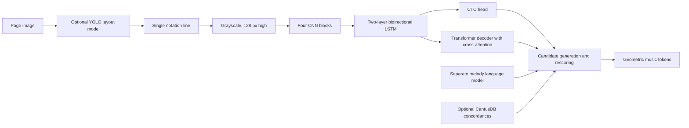

# Optical Music Recognition for Gregorian chant

This repository provides a standalone inference package for the `hybrid_hybrid_general_v10` CRNN/Transformer model. It includes the `decoder_lm_diff` melody model, the CantusDB fields needed for concordance scoring, and two page layout models. Training images and internal research documents are not needed to run inference and are not included.

## Installation

Use Python 3.12 or newer and install a PyTorch build suitable for your CPU or NVIDIA GPU.

```bash
python -m venv .venv
.venv/bin/python -m pip install -r requirements.txt
```

## Read a notation line

The most reliable input is an image cropped to a **single notation line** (JPG or PNG). The command prints JSON containing geometric music tokens. `gelesen` combines the image model and melody model; `ohne_vorwissen` uses only the image model's CTC and attention scores.

```bash
.venv/bin/python -m omr.predict examples/001r_01_with_clef.jpg
```

If the CantusDB source ID and folio are known, add concordance scoring:

```bash
.venv/bin/python -m omr.predict examples/001r_01_with_clef.jpg --source-id 123667 --folio 001r
```

Use `--bbox X1 Y1 X2 Y2` to select a notation line within a larger image. The compact `weights/cantus_rag.sqlite` database is used only when both `--source-id` and `--folio` are supplied.

The token sequence uses `l1`, `l2`, etc. for staff lines, `z1`, `z2`, etc. for spaces, clef tokens such as `f2`, and `,` as the separator used by the model. The returned `konfidenz` is an attention log score per token; higher values indicate a better model fit. It is not a calibrated probability.

## Read a full page

`omr.page` detects notation regions with YOLO and reads each region. Treat these results as a preview: inspect the reported bounding boxes and reread individual lines with `--bbox` where needed.

```bash
.venv/bin/python -m omr.page page.jpg --layout handschrift
.venv/bin/python -m omr.page page.jpg --layout druck
```

The page command also accepts `--source-id` and `--folio`. CUDA is selected automatically when available; use `--device cpu` to force CPU inference. The JSON output includes each region's coordinates.

Check the bundled example against its reference transcription:

```bash
.venv/bin/python -m omr.check
```

## Model architecture (23 October 2026 checkpoint)

The recognizer works on one cropped staff system at a time. It predicts **written staff geometry**, not pitches directly. Pitch can be derived from a note's staff position and the clef that the model read. It does not recognize lyrics.



**Visual encoder and two heads.** Four 3×3 convolutional blocks use 32, 64, 128 and 256 channels with batch normalization, LeakyReLU and pooling. They reduce the image width by a factor of four and yield 2,048 features per time step. A two-layer bidirectional LSTM with 256 hidden units in each direction produces 512 features per step. The LSTM follows image width (`batch_first=True`). A linear CTC head assigns a token or blank at each step. In parallel, a six-layer autoregressive Transformer decoder (width 256, four attention heads, feed-forward width 1,024) uses both its preceding tokens and cross-attention to the LSTM states. The hybrid checkpoint has about 14.3 million parameters.

**Vocabulary.** The original CTC vocabulary has 59 music tokens plus a blank. The 23 October checkpoint adds `c5`, giving 60 music tokens plus a blank. The decoder has 69 entries: 65 original music tokens, three control tokens (`<pad>`, `<bos>`, `<eos>`), and `c5`. Decoder hypotheses containing a token absent from the CTC vocabulary are discarded before joint scoring. Staff positions are encoded as `l1`, `l2`, ... (lines) and `z1`, `z2`, ... (spaces); other tokens encode clefs, accidentals, separators and section bars. Liquescent forms and custodes are not represented.

**Training lineage.** The visual encoder and CTC head began with CRNN v3 weights. The Transformer's token embeddings, self-attention and feed-forward layers began with weights from a melody model trained on CantusDB sequences; cross-attention was new. The resulting base hybrid (`hybrid_hybrid_lang`) was trained on the older ground truth. The 23 October `general_v10` checkpoint was fine-tuned from that base model using the ground-truth mix described below.

**Independent melody model.** `decoder_lm_diff` is a separate six-layer causal Transformer trained to predict the next music token from CantusDB melodies, including psalm differentiae. It is kept fixed while reading images and scores each candidate as an additional signal (*shallow fusion*). The hybrid decoder was initialized from the earlier `decoder_lm` model; `decoder_lm_diff` is the separate model used at inference. Its checkpoint predates `c5`; the inference code adds an approximate `c5` embedding so that the vocabularies align.

**Candidate selection.** The packaged command generates up to six attention beam hypotheses plus a CTC greedy reading. It also tests alternative initial clefs for the best hypotheses. Every candidate is scored by the CTC head, attention decoder and separate melody model:

```text
score = 0.3 × CTC + 0.7 × attention + 0.1 × melody model
        + 1.0 × concordance (when source ID and folio are supplied)
```

These are sums of log scores, except for the concordance bonus; they are not probabilities. This packaged command has no length bonus (`β = 0`), although some earlier experiments used one. Concordance scoring obtains the chants assigned to the folio from the bundled compact CantusDB extract, compares each candidate's pitches with versions in other sources, and checks the majority transposition before rewarding a changed clef. It chooses among image-generated candidates; it does not copy a database melody into the output. Without a source ID and folio, this term is absent.

**Scope.** The optional YOLO models locate notation regions on full pages. The packaged page command uses their rectangular boxes as an automatic preview; it does not implement the full editorial reading-order or ground-truth review workflow described in the research report. The checkpoint dates from 23 October 2026. Metrics reported for earlier checkpoints or different decoding settings should not be read as a benchmark for this exact command.

## Training and ground truth for `general_v10`

The checkpoint was built in three stages:

1. A causal melody model learned token sequences converted from CantusDB melodies. The image model's decoder was initialized from that model; its cross-attention layers were initialized separately. The separate `decoder_lm_diff` checkpoint used for inference was trained on a corpus that also included psalm differentiae.
2. The base image model `hybrid_hybrid_lang` started from CRNN v3 encoder and CTC weights and learned the older Volpiano-based ground truth with a pretrained decoder. Both heads used a joint loss of `0.3 × CTC + 0.7 × cross-entropy`.
3. `general_v10` started from that base hybrid and was fine-tuned for ten epochs on the combined index below. The older examples were retained during fine-tuning to prevent forgetting; the newer source examples were entered three times each so they had sufficient weight. The training run used batch size 16, AdamW, a OneCycle learning-rate schedule peaking at `1e-4`, label smoothing 0.1 for the decoder, gradient clipping at 5, and geometric and photometric image augmentation. The checkpoint was selected by attention validation symbol error rate on 800 sampled validation lines.

The following counts are **entries accepted by the training data loader**, not counts of independent manuscript systems. The older index already contains repeat copies; the threefold weighting of the newer lines is included in the training column.

| Ground-truth component | Training entries used | Validation | Test | Origin and split |
| --- | ---: | ---: | ---: | --- |
| Older Volpiano-based GT (`volpiano4`) | 33,338 | 3,109 | 3,084 | About 32,746 aligned line images from ten sources (eleven exports), with pre-existing repeat copies and 947 training-only A-KN 1012 silver lines. The 3,084-line fixed test set was retained. |
| Curated source GT (`gesamt12`) | 24,240 (8,080 lines × 3) | 854 | 922 | Checked Transkribus and source-specific GT from 28 source IDs, including the five-line A-MB Man.Perg. 2 material, corrected Aldersbach lines, and Vorau clef silver data. |
| Salzinnes (AMNLT) | 2,400 (800 lines × 3) | 80 | 220 | Folio-level split; training selection emphasizes F clefs and internal clef changes. |
| Solesmes (AMNLT) | 1,146 (382 lines × 3) | 51 | 76 | Source-page-level split. |
| **Total** | **61,124** | **4,094** | **4,302** | The AMNLT data were split by page or folio rather than retaining their original line-level splits. |

The source project's 23 October log reports **5.72% token symbol error rate** for `general_v10` on the fixed 3,084-line test set using its original joint-decoding evaluation. That measurement uses settings different from this package's default command and is not an accuracy claim for `omr.predict` or `omr.page`. The bundled `omr.check` is a compatibility check on one example, not a benchmark.

The image GT, complete CantusDB, training scripts, and the human/agent review workflow are not included in this inference repository. Only the model weights, vocabularies, compact concordance extract, inference code and example are included.

## Contents and provenance

- `omr/model.py`: CRNN/Transformer architecture and beam search, adapted for inference from `skripte/hybrid.py`, `skripte/decoder_lm.py`, `skripte/joint.py`, and `omr_cli/src/core/models/crnn.py` in the source projects.
- `omr/predict.py`: image preprocessing, candidate generation, and combined CTC/attention/melody-model scoring.
- `omr/rag.py`: concordance scoring adapted from `skripte/rag_bewertung.py`, `rag_bewertung2.py`, `rag_bewertung3.py`, and `lesen_rag.py`.
- `omr/page.py`: optional page layout detection. Its weights come from `modelle/layout/{handschrift,druck}_s1/weights/best.pt`.
- `weights/hybrid_hybrid_general_v10.pt`: OMR model weights from 23 October 2026, including the `c5` token.
- `weights/decoder_lm_diff.pt`: melody model trained with psalm differentiae. The two vocabulary JSON files define the token order.
- `weights/cantus_rag.sqlite`: compact CantusDB extract containing only `source_id`, `folio`, `sequence`, `cantus_id`, and `volpiano`.

This package runs the supplied weights. The full training corpus and training scripts are outside its scope.
