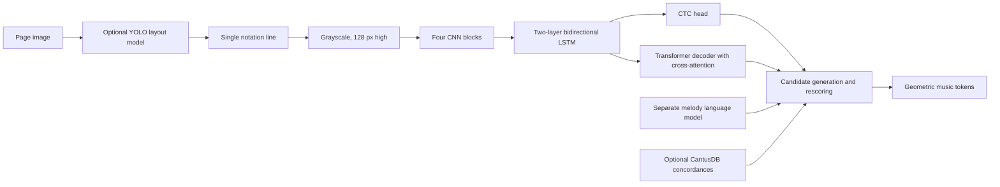

# Optical Music Recognition for Gregorian chant

This repository provides a standalone inference package for the `hybrid_hybrid_general_v10` CRNN/Transformer model. It includes the `decoder_lm_diff` melody model, the CantusDB fields needed for concordance scoring, and two page layout models. Training images and internal research documents are not needed to run inference and are not included.

## Installation

Use Python 3.12 or newer and install a PyTorch build suitable for your CPU or NVIDIA GPU.

```bash
python -m venv .venv
.venv/bin/python -m pip install -r requirements.txt
```

## Read a notation line

The most reliable input is an image cropped to a **single notation line** (JPG or PNG). The command prints JSON containing geometric music tokens. `gelesen` combines the image model and melody model; `ohne_vorwissen` uses only the image model's CTC and attention scores.

```bash
.venv/bin/python -m omr.predict examples/001r_01_with_clef.jpg
```

If the CantusDB source ID and folio are known, add concordance scoring:

```bash
.venv/bin/python -m omr.predict examples/001r_01_with_clef.jpg --source-id 123667 --folio 001r
```

Use `--bbox X1 Y1 X2 Y2` to select a notation line within a larger image. The compact `weights/cantus_rag.sqlite` database is used only when both `--source-id` and `--folio` are supplied.

The token sequence uses `l1`, `l2`, etc. for staff lines, `z1`, `z2`, etc. for spaces, clef tokens such as `f2`, and `,` as the separator used by the model. The returned `konfidenz` is an attention log score per token; higher values indicate a better model fit. It is not a calibrated probability.

## Read a full page

`omr.page` detects notation regions with YOLO and reads each region. Treat these results as a preview: inspect the reported bounding boxes and reread individual lines with `--bbox` where needed.

```bash
.venv/bin/python -m omr.page page.jpg --layout handschrift
.venv/bin/python -m omr.page page.jpg --layout druck
```

The page command also accepts `--source-id` and `--folio`. CUDA is selected automatically when available; use `--device cpu` to force CPU inference. The JSON output includes each region's coordinates.

Check the bundled example against its reference transcription:

```bash
.venv/bin/python -m omr.check
```

## Model architecture (23 October 2026 checkpoint)

The recognizer works on one cropped staff system at a time. It predicts **written staff geometry**, not pitches directly. Pitch can be derived from a note's staff position and the clef that the model read. It does not recognize lyrics.



**Visual encoder and two heads.** Four 3×3 convolutional blocks use 32, 64, 128 and 256 channels with batch normalization, LeakyReLU and pooling. They reduce the image width by a factor of four and yield 2,048 features per time step. A two-layer bidirectional LSTM with 256 hidden units in each direction produces 512 features per step. The LSTM follows image width (`batch_first=True`). A linear CTC head assigns a token or blank at each step. In parallel, a six-layer autoregressive Transformer decoder (width 256, four attention heads, feed-forward width 1,024) uses both its preceding tokens and cross-attention to the LSTM states. The hybrid checkpoint has about 14.3 million parameters.

**Vocabulary.** The original CTC vocabulary has 59 music tokens plus a blank. The 23 October checkpoint adds `c5`, giving 60 music tokens plus a blank. The decoder has 69 entries: 65 original music tokens, three control tokens (`<pad>`, `<bos>`, `<eos>`), and `c5`. Decoder hypotheses containing a token absent from the CTC vocabulary are discarded before joint scoring. Staff positions are encoded as `l1`, `l2`, ... (lines) and `z1`, `z2`, ... (spaces); other tokens encode clefs, accidentals, separators and section bars. Liquescent forms and custodes are not represented.

**Training lineage.** The visual encoder and CTC head began with CRNN v3 weights. The Transformer's token embeddings, self-attention and feed-forward layers began with weights from a melody model trained on CantusDB sequences; cross-attention was new. The resulting base hybrid (`hybrid_hybrid_lang`) was trained on the older ground truth. The 23 October `general_v10` checkpoint was fine-tuned from that base model using the ground-truth mix described below.

**Independent melody model.** `decoder_lm_diff` is a separate six-layer causal Transformer trained to predict the next music token from CantusDB melodies, including psalm differentiae. It is kept fixed while reading images and scores each candidate as an additional signal (*shallow fusion*). The hybrid decoder was initialized from the earlier `decoder_lm` model; `decoder_lm_diff` is the separate model used at inference. Its checkpoint predates `c5`; the inference code adds an approximate `c5` embedding so that the vocabularies align.

**Candidate selection.** The packaged command generates up to six attention beam hypotheses plus a CTC greedy reading. It also tests alternative initial clefs for the best hypotheses. Every candidate is scored by the CTC head, attention decoder and separate melody model:

```text
score = 0.3 × CTC + 0.7 × attention + 0.1 × melody model
        + 1.0 × concordance (when source ID and folio are supplied)
```

These are sums of log scores, except for the concordance bonus; they are not probabilities. This packaged command has no length bonus (`β = 0`), although some earlier experiments used one. Concordance scoring obtains the chants assigned to the folio from the bundled compact CantusDB extract, compares each candidate's pitches with versions in other sources, and checks the majority transposition before rewarding a changed clef. It chooses among image-generated candidates; it does not copy a database melody into the output. Without a source ID and folio, this term is absent.

**Optional clef lock.** `--lm-clef-lock` (off by default, available in `omr.predict` and `omr.page`) keeps the melody model from changing the initial clef. The score without the melody model (image heads plus concordance, when supplied) fixes the clef first, and the melody model then chooses only among candidates with that clef. Concordance scoring can still change the clef. See the [clef-lock ablation](#melody-model-and-the-initial-clef) before enabling it.

**Scope.** The optional YOLO models locate notation regions on full pages. The packaged page command uses their rectangular boxes as an automatic preview; it does not implement the full editorial reading-order or ground-truth review workflow described in the research report. The checkpoint dates from 23 October 2026. Metrics reported for earlier checkpoints or different decoding settings should not be read as a benchmark for this exact command.

## Measured results and ablations

**Symbol error rate (SER)** is edit distance over music tokens divided by the number of reference tokens; lower is better. The line-level results below use ground-truth crops. They come from distinct, explicitly named experiments in the source project and must not be combined into a single score for the packaged page command. The fixed test set has 3,084 lines from the older sources. The A-KN 1012 leave-one-source-out (LOSO) test has 1,175 lines from a manuscript excluded from that experiment's image-model training.

### Decoder initialization: with and without melody-LM pretraining

Both hybrid variants use the same older training index and fixed test set, a CRNN v3 encoder initialization, 25 training epochs, and joint CTC/attention decoding with weights selected on validation data. Here **LM pretraining** means initializing the image model's Transformer decoder from a CantusDB melody model *before image training*; it is separate from adding a third scoring model at inference.

| Image model | Decoder initialized from melody LM? | CTC SER | Attention SER | Joint SER |
| --- | :---: | ---: | ---: | ---: |
| CTC-only baseline, corrected LSTM | No decoder | 7.09% | — | — |
| Hybrid (`hybrid_hybrid_lang`) | Yes | 7.38% | 6.50% | **5.71%** |
| Hybrid (`hybrid_scratch`) | No | 7.25% | 6.82% | 5.85% |

Source: `docs/hybrid_vergleich.md` in the training project. The decoder-pretraining comparison concerns the earlier hybrid checkpoints, not a retraining of `general_v10`.

### Third scoring model and CantusDB concordances

The **third scoring model** is an independent melody LM used to rerank image-model candidates (*shallow fusion*). The concordance term compares them with CantusDB versions from other sources. Each row below changes these two inference signals while keeping its own test set and image checkpoint fixed. Candidate generation here used beam 12 and alternative initial clefs. The CTC/attention length bonus and the LM/concordance weights were selected separately on validation data; thus this is an ablation of the complete selection procedure, not a fixed-weight toggle test.

| Evaluation / image checkpoint | Independent melody LM | CantusDB concordances | Test token SER |
| --- | :---: | :---: | ---: |
| Fixed 3,084 lines / `hybrid_hybrid_lang` | No | No | 5.67% |
| Fixed 3,084 lines / `hybrid_hybrid_lang` | Yes* | No | 5.67% |
| Fixed 3,084 lines / `hybrid_hybrid_lang` | No | Yes | 5.66% |
| Fixed 3,084 lines / `hybrid_hybrid_lang` | Yes | Yes | **5.64%** |
| A-KN 1012 LOSO, 1,175 lines / `hybrid_scratch_loso1012` | No | No | 13.08% |
| A-KN 1012 LOSO, 1,175 lines / `hybrid_scratch_loso1012` | Yes | No | 12.70% |
| A-KN 1012 LOSO, 1,175 lines / `hybrid_scratch_loso1012` | No | Yes | 12.89% |
| A-KN 1012 LOSO, 1,175 lines / `hybrid_scratch_loso1012` | Yes | Yes | **12.66%** |

*For the fixed-set LM-only row, validation selected an LM weight of zero, so that row is numerically identical to the no-prior baseline. The LOSO image model excluded A-KN 1012 from training, and its independent melody LM excluded that source's melodies; concordances came from other sources. These four-way results are from `docs/rag.md` (`fest2` and `loso1012_2`) in the training project. The image checkpoints and LM in these ablations differ from the bundled `general_v10` and `decoder_lm_diff` weights.

A later concordance variant restricts clef changes to the majority transposition of the matched melodies. With this guard, the **combined** LM and concordance path measured 5.65% token SER and 5.78% melody SER on the fixed set (baseline 5.67% / 5.97%), and 12.63% / 15.52% on A-KN 1012 (baseline 13.08% / 18.47%). These are the reproducibility-corrected results in `docs/rag.md`; melody SER measures pitches after applying the read clef, not the geometric tokens used for token SER.

The bundled `general_v10` checkpoint has a separate **5.72% joint token SER** on the fixed 3,084-line test set under the original `skripte/joint.py` beam-6 protocol (validation-selected CTC weight 0.5 and length bonus 1.0; source: `docs/hybrid_hybrid_general_v10.md`). The package's `omr.predict` uses different weights and no length bonus. No SER for the exact packaged command or end-to-end page pipeline has been measured here.

### Melody model and the initial clef

The independent melody LM often changes the initial clef. The clef lock prevents that. The table uses the fixed 3,084 lines, `hybrid_hybrid_lang`, beam 12 with alternative initial clefs, and the weights stated in the first column. It does not use the bundled `general_v10` checkpoint.

| Length bonus β / LM μ / concordance ρ | Variant | Token SER | Note SER | Melody SER | Correct initial clefs (of 3,069) |
| --- | --- | ---: | ---: | ---: | ---: |
| 0.5 / 0 / 0 | No prior knowledge | 5.67% | 5.15% | 5.97% | 2,926 |
| 0.5 / 0.1 / 0 | Melody LM | 5.69% | 5.13% | 6.04% | 2,837 |
| 0.5 / 0.1 / 0 | Melody LM, clef lock | 5.64% | 5.13% | 6.07% | 2,926 |
| 0.5 / 0.05 / 0.5 | Melody LM + concordance | 5.65% | 5.13% | 5.78% | 2,898 |
| 0.5 / 0.05 / 0.5 | Melody LM + concordance, clef lock | 5.63% | 5.13% | 5.96% | 2,926 |
| 0 / 0.1 / 1 | Packaged weights | 5.71% | 5.13% | 6.10% | 2,829 |
| 0 / 0.1 / 1 | Packaged weights, clef lock | 5.67% | 5.13% | 6.41% | 2,912 |

The lock raises initial-clef accuracy and slightly lowers token SER, but melody SER does not improve and becomes worse together with concordance scoring. The reason has not been established. The lock therefore stays off by default. It is not tested on an unseen manuscript. Source: `docs/hybrid_vergleich.md` in the training project.

### CTC without the Transformer decoder

Prefix beam search (width 64) over a CTC-only model, with the unchanged melody LM rescoring the candidates, measured on the fixed 3,084 lines. The CTC-only model is the ONNX export of `hybrid_ctc_lang`; the length bonus and LM weight were selected on validation data.

| Decoding | Token SER | Without separators | Note SER | Correct initial clefs (of 3,069) |
| --- | ---: | ---: | ---: | ---: |
| CTC greedy | 7.08% | 6.45% | 6.05% | 2,754 |
| CTC prefix beam | 6.86% | 6.32% | 5.92% | 2,753 |
| CTC prefix beam + melody LM | 6.70% | 6.20% | 5.69% | 2,642 |
| Hybrid joint decoding (`hybrid_hybrid_lang`, beam 6) | 5.71% | 5.37% | 5.19% | 2,929 |
| Best of the 64 CTC candidates (oracle) | 4.92% | 4.97% | 4.75% | 2,869 |

Beam search and the melody LM recover 0.38 of the 1.37 points between CTC greedy and joint decoding, so they do not replace the decoder. The oracle row shows that better readings are often already among the candidates; selection is the limiting step. This path was not tested on an unseen manuscript, because the CTC-only LOSO weights no longer exist.

### Padding in the BiLSTM

The BiLSTM in the training and research code runs over the white padding of a batch, so a reading can depend on its neighbours in the batch. Measured with `hybrid_hybrid_lang` on the fixed 3,084 lines (batch 16, index order, 10.9% padding frames, greedy decoding):

| Head | Padded batch | Each line alone | `pack_padded_sequence` |
| --- | ---: | ---: | ---: |
| CTC | 7.40% | 7.45% | 7.47% |
| Attention | 6.42% | 6.63% | 6.94% |

Compared with reading each line alone, 436 CTC readings and 238 attention readings change, but accuracy does not suffer. The packed variant is applied to a model trained with padding, so it is not a retraining result. `omr.predict` reads each line alone and is therefore independent of batch composition; on this earlier checkpoint that setting measured slightly worse for attention than padded batches.

### YOLO page-layout models

The packaged `handschrift` and `druck` weights are the final YOLO26s-seg `best.pt` checkpoints. The test sets were held out **by source**, and the comparison is against existing PAGE-XML region labels. Box metrics apply to the rectangular detections used by `omr.page`; mask metrics assess the segmentation output of the weights, although the page command currently uses boxes.

| Layout model | Held-out test pages | Box mAP@50 | Box mAP@50:95 | Mask mAP@50 | Mask mAP@50:95 |
| --- | ---: | ---: | ---: | ---: | ---: |
| Manuscripts (`layout_handschrift.pt`) | 1,938 | 0.8813 | 0.6853 | 0.8812 | 0.6327 |
| Prints (`layout_druck.pt`) | 1,256 | 0.9588 | 0.7754 | 0.9638 | 0.7613 |

Source: `docs/yolo_layout_bericht.md`, “Abschluss und Testsplit-Ergebnisse (25.10.2026)”, in the training project. These are aggregate region-detection scores, not notation-only recall, independently verified polygon accuracy, or end-to-end page transcription SER. The documented A-KN 1012 layout transfer probe showed weak detection of notation on an atypical manuscript, so the scores should not be generalized to every source style.

## Training and ground truth for `general_v10`

The checkpoint was built in three stages:

1. A causal melody model learned token sequences converted from CantusDB melodies. The image model's decoder was initialized from that model; its cross-attention layers were initialized separately. The separate `decoder_lm_diff` checkpoint used for inference was trained on a corpus that also included psalm differentiae.
2. The base image model `hybrid_hybrid_lang` started from CRNN v3 encoder and CTC weights and learned the older Volpiano-based ground truth with a pretrained decoder. Both heads used a joint loss of `0.3 × CTC + 0.7 × cross-entropy`.
3. `general_v10` started from that base hybrid and was fine-tuned for ten epochs on the combined index below. The older examples were retained during fine-tuning to prevent forgetting; the newer source examples were entered three times each so they had sufficient weight. The training run used batch size 16, AdamW, a OneCycle learning-rate schedule peaking at `1e-4`, label smoothing 0.1 for the decoder, gradient clipping at 5, and geometric and photometric image augmentation. The checkpoint was selected by attention validation symbol error rate on 800 sampled validation lines.

The following counts are **entries accepted by the training data loader**, not counts of independent manuscript systems. The older index already contains repeat copies; the threefold weighting of the newer lines is included in the training column.

| Ground-truth component | Training entries used | Validation | Test | Origin and split |
| --- | ---: | ---: | ---: | --- |
| Older Volpiano-based GT (`volpiano4`) | 33,338 | 3,109 | 3,084 | About 32,746 aligned line images from ten sources (eleven exports), with pre-existing repeat copies and 947 training-only A-KN 1012 silver lines. The 3,084-line fixed test set was retained. |
| Curated source GT (`gesamt12`) | 24,240 (8,080 lines × 3) | 854 | 922 | Checked Transkribus and source-specific GT from 28 source IDs, including the five-line A-MB Man.Perg. 2 material, corrected Aldersbach lines, and Vorau clef silver data. |
| Salzinnes (AMNLT) | 2,400 (800 lines × 3) | 80 | 220 | Folio-level split; training selection emphasizes F clefs and internal clef changes. |
| Solesmes (AMNLT) | 1,146 (382 lines × 3) | 51 | 76 | Source-page-level split. |
| **Total** | **61,124** | **4,094** | **4,302** | The AMNLT data were split by page or folio rather than retaining their original line-level splits. |

The `general_v10` joint-decoding result and its protocol are reported in the results section above. The bundled `omr.check` is a compatibility check on one example, not a benchmark.

The image GT, complete CantusDB, training scripts, and the human/agent review workflow are not included in this inference repository. Only the model weights, vocabularies, compact concordance extract, inference code and example are included.

## Contents and provenance

- `omr/model.py`: CRNN/Transformer architecture and beam search, adapted for inference from `skripte/hybrid.py`, `skripte/decoder_lm.py`, `skripte/joint.py`, and `omr_cli/src/core/models/crnn.py` in the source projects.
- `omr/predict.py`: image preprocessing, candidate generation, and combined CTC/attention/melody-model scoring.
- `omr/rag.py`: concordance scoring adapted from `skripte/rag_bewertung.py`, `rag_bewertung2.py`, `rag_bewertung3.py`, and `lesen_rag.py`.
- `omr/page.py`: optional page layout detection. Its weights come from `modelle/layout/{handschrift,druck}_s1/weights/best.pt`.
- `weights/hybrid_hybrid_general_v10.pt`: OMR model weights from 23 October 2026, including the `c5` token.
- `weights/decoder_lm_diff.pt`: melody model trained with psalm differentiae. The two vocabulary JSON files define the token order.
- `weights/cantus_rag.sqlite`: compact CantusDB extract containing only `source_id`, `folio`, `sequence`, `cantus_id`, and `volpiano`.

This package runs the supplied weights. The full training corpus and training scripts are outside its scope.

## Acknowledgements

The training CLI and the original CNN–BiLSTM–CTC (CRNN) architecture come from the Pattern Recognition and Artificial Intelligence Group (PRAIG) at the University of Alicante. They were developed in the collaboration between PRAIG and the Austrian Academy of Sciences on plainchant OMR. The upstream CLI is available at [ACDHxUA/CLI](https://github.com/ACDHxUA/CLI); its initial code release was committed by Adrián Roselló.

This project builds on that CRNN baseline and training framework. We thank Jorge Calvo-Zaragoza and the PRAIG team for their collaboration. The hybrid CTC/attention extension, melody-model scoring and CantusDB concordance scoring described above were added in this project.
